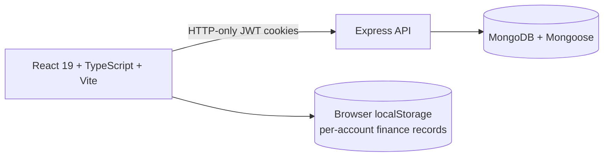

<div align="center">


<a href="https://finsight-personal-finance.onrender.com">
  
</a>

**An elegant, motion-driven personal finance dashboard for modern money routines.**

<br/>

[](https://finsight-personal-finance.onrender.com)
[](https://github.com/Dhruvi-tech/Finsight-Finance)


</div>

<br/>

> [!TIP]
> **Try it in 10 seconds.** Open the [live demo](https://finsight-personal-finance.onrender.com) and choose **Demo sign in** on the welcome screen. No account needed.

<br/>

## ✦ Experience FinSight

FinSight makes money management feel intuitive, calm and insightful. Your everyday expenses, monthly budgets, long-term savings goals and cash flow forecasts live in one fluid, motion-aware workspace.

<table>
<tr>
<td width="33%" valign="top">

### 📊 See the whole picture
Track income, expenses, interactive monthly rhythm charts and your category mix in real time.

</td>
<td width="33%" valign="top">

### 🎯 Make a confident plan
Set category limits, milestone-based savings goals and forward projections.

</td>
<td width="33%" valign="top">

### ⚡ Stay on track
Instant search (`⌘K`), Quick Add (`N`), CSV/PDF exports and the FinSight AI assistant.

</td>
</tr>
</table>

<br/>

## ✨ Key Capabilities

| | Feature | What it does |
| :-: | :-- | :-- |
| 📒 | **Fluid ledger** | Log income and expenses with categories, payment methods and notes. Filter, edit inline and export to CSV. |
| 🗂️ | **Toggleable sidebar** | Hide the whole navigation panel with `☰` or `✕` for an expansive full-screen canvas. |
| 📈 | **Cash flow and spending mix** | Monthly trend line/bar charts and a category donut, powered by Recharts. |
| 🚦 | **Budgets and pace alerts** | Monthly limits with animated progress bars, warning badges and live pace tracking. |
| 🏆 | **Savings milestones** | Milestone badges and progress indicators, plus a rotating orbit that shows goals approaching. |
| 🔮 | **30-day outlook** | Detects recurring subscriptions and projects end-of-month cash flow. |
| 📅 | **Calendar and bill reminders** | Upcoming payments on a calendar with quick paid/unpaid toggles. |
| 🤖 | **FinSight AI assistant** | Fast, rule-based answers and tips tailored to your ledger. |
| 🧾 | **PDF reports** | Structured, professional period summaries on demand. |
| 🌙 | **Micro-interactions and dark mode** | Hover lifts, shimmering progress bars, breathing status indicators and keyboard shortcuts. |

<br/>

## 🚀 Quick Start

Requires **Node.js 24+** and **npm**.

```sh
# 1. Install dependencies
npm ci
npm ci --prefix client

# 2. Start the development servers
npm run dev
```

| Service | URL |
| :-- | :-- |
| Client | `http://localhost:5173` |
| API | `http://localhost:4000` |

### Quality checks and build

```sh
npm test         # run the test suite
npm run build    # build the client production bundle
```

<br/>

## 🛠️ Tech Architecture



| Layer | Stack |
| :-- | :-- |
| 🎨 **Frontend** | React 19, TypeScript 5, Vite, Recharts, Lucide Icons, jsPDF and a custom CSS motion system |
| ⚙️ **Backend** | Node.js, Express, MongoDB, Mongoose, bcrypt, signed HTTP-only JWT cookies, Zod validation, Helmet and rate limiting |
| 🔒 **Storage** | Finance records persist in browser `localStorage`, scoped per account. Zero-latency, private and no bank credentials needed. |

<br/>

## 🌐 Deployment and Repository

| | Link |
| :-- | :-- |
| **Live application** | [finsight-personal-finance.onrender.com](https://finsight-personal-finance.onrender.com) |
| **Source code** | [github.com/Dhruvi-tech/Finsight-Finance](https://github.com/Dhruvi-tech/Finsight-Finance) |

<br/>

<div align="center">


<sub>© 2026 FinSight · Crafted with care for your next money move.</sub>

</div>


---

## ✨ Premium Experience & Visual System (v2.4 Upgrade)

The FinSight platform has been upgraded with an ultra-premium visual design system engineered for financial clarity, sensory elegance, and fluid micro-interactions:

- **Ambient Glowing Particle Atmosphere:** Dynamic floating luminous gradient orbs and twinkling star particles (`✦`) creating depth while maintaining lightweight performance.
- **Next-Gen Frosted Glassmorphism:** High-precision backdrop blurs (`backdrop-filter: blur(16px - 20px)`) across all dashboard cards, navigation panels, modal overlays, and quick-add surfaces with subtle translucent borders.
- **Luminous Interactive Charts:** Multi-stop area gradients for cashflow visualization with drop-shadow glow filters, animated active radar dots, and custom glassmorphic floating tooltips displaying real-time financial stats.
- **Dynamic Micro-Interactions & Shimmers:**
  - 3D hover elevation and gentle scale transitions on metric cards, goal blocks, and budget categories.
  - Continuous diagonal light-sweep shimmer animations across primary call-to-action buttons.
  - Multi-stop gradient shimmer animations across budget progress bars and savings metrics.
  - Rotating dual-ring dashed orbital tracks for active savings goal targets.
  - Breathing radar indicators for live financial feeds and holographic badge effects for FinSight AI.
- **Full Sidebar Auto-Retraction & Smooth Reflow:** Seamless zero-width sidebar toggling via `☰` and `✕` with fluid width and margin transitions ensuring 100% full-screen canvas expansion.
- **Verified Production Deployment:** Fully optimized Vite production bundles deployed directly to Render with automated CI validation.
